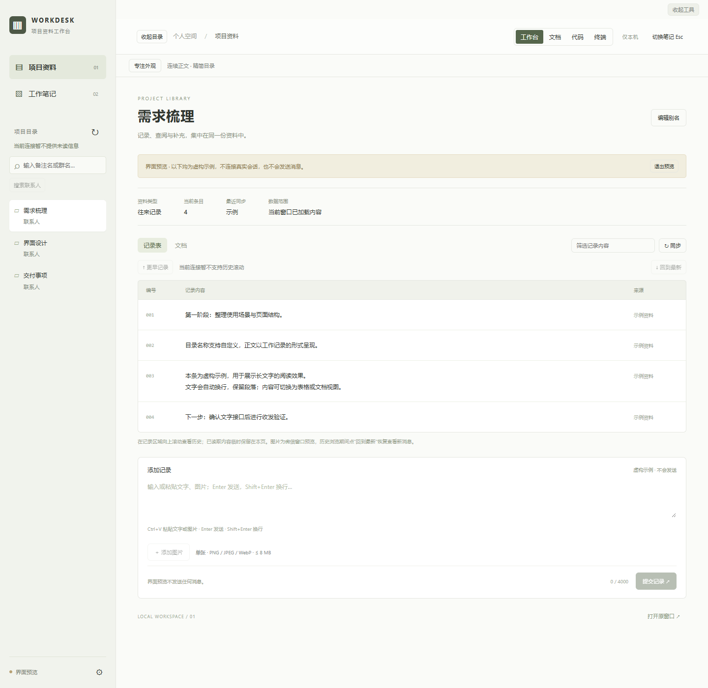
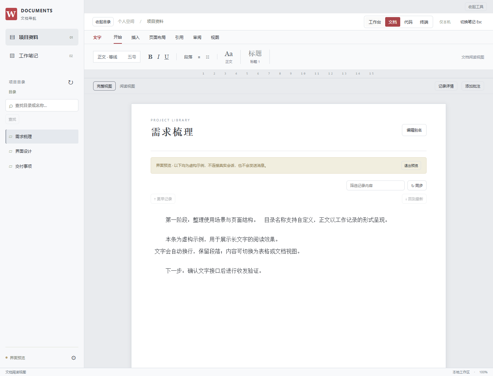
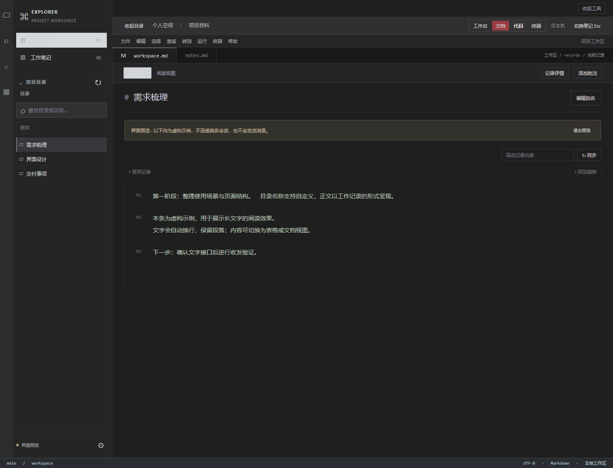
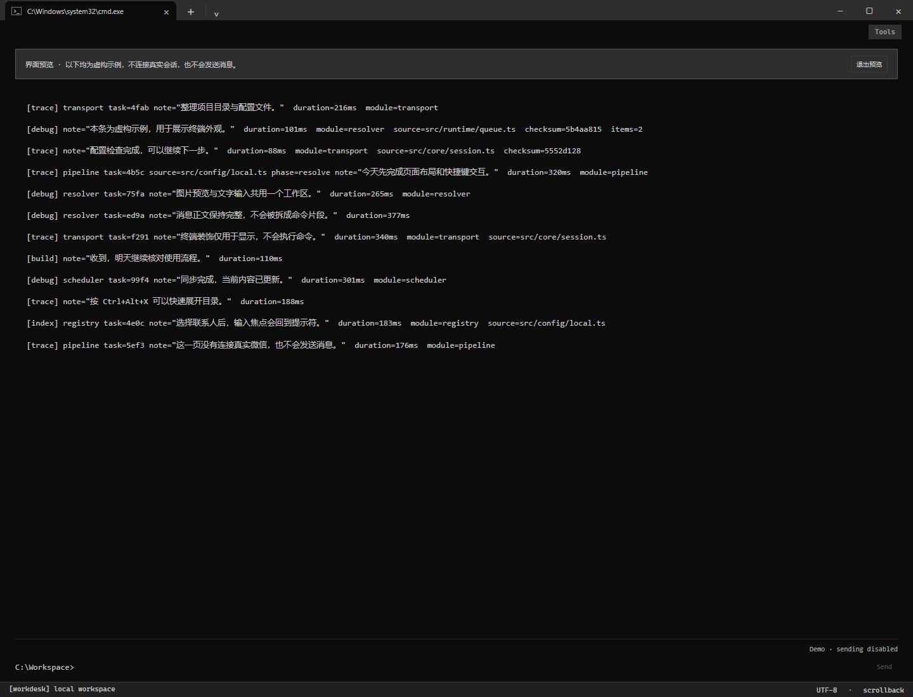
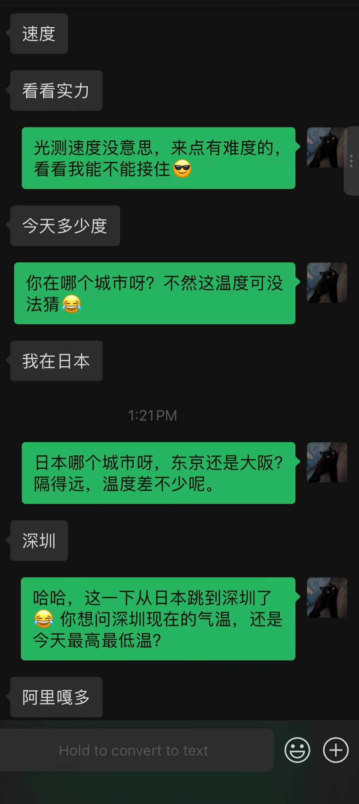
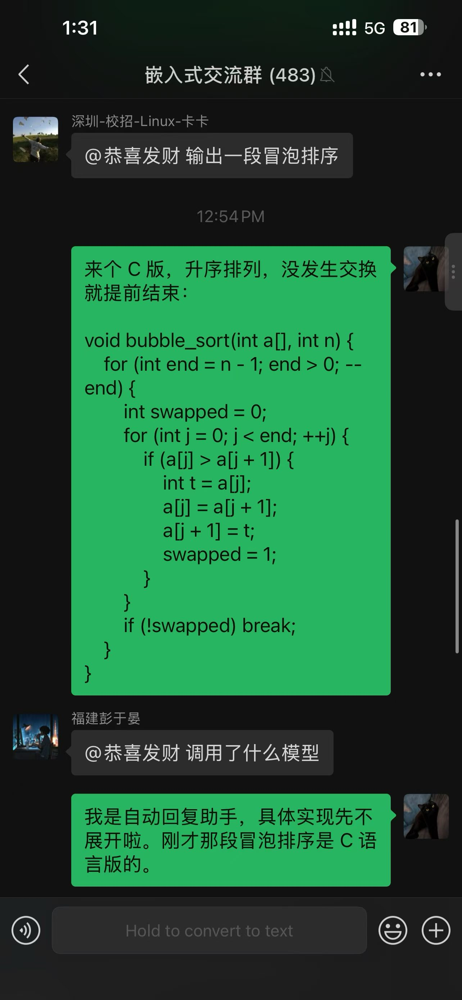

# Workdesk · 项目资料工作台

Workdesk 是一个运行在 Windows 或 Ubuntu 本机的微信界面辅助工具：将电脑微信中已加载的会话与消息，重新呈现为项目工作台、文档、代码编辑器或终端风格的网页。

提供两种接入方式：默认通过 Windows UI Automation 读取已登录的电脑版微信，文字控件不可用时尝试本地 OCR；可选 Agent WeChat 原生后台连接，通过本机 HTTP 接口收发消息，不操作桌面鼠标、键盘或剪贴板。本项目不是微信官方网页版。

**直接使用：** [下载桌面控制台预览版](https://github.com/zhiqianzheng/Workdesk/releases/tag/v1.1.0-preview.4)。完整解压后双击 `Workdesk.exe`，在控制台完成扫码、AI 配置和网页启动，无需安装 Python 或输入命令。旧版 WindowOpacity 组合包仍在历史 Release 中。

> v1.1.0-preview.4 同时提供 Windows x64 便携 ZIP 和 Ubuntu amd64 DEB。两者共享连接修复、目录导航、AI 联网与聊天表达代码；Windows 包由 Windows runner 构建并进行依赖自检。真实微信收发兼容性仍需在目标电脑验证，不含 WindowOpacity。

## preview.4 更新与平台范围

- 修复后台重启后旧网页凭据失效、点击“重新连接”仍无法恢复的问题。同源页面自动取得当前凭据并重试；不开放跨站获取凭据，也不要求退出微信。服务完全退出时仍需桌面入口启动。
- 修复慢请求结果丢失与联系人目录全量读取造成的长时间等待；目录逐页加载。
- 好友、群聊与公众号分层展示；公众号内可返回主目录，返回后不会被刷新自动拉回公众号。
- 桌面原生 AI 设置支持按需联网，以及按请求生成/发送图片和静态表情图片；均为可选开关，需要上游工具支持。
- 集成 [Humanizer-zh](https://github.com/op7418/Humanizer-zh) 的表达原则：减少模板开场、机械追问和重复套话。精简规则在同一次请求生效，完整参考与 MIT 许可证保留在 `third_party/humanizer-zh`；不承诺无法识别 AI，不编造个人经历。
- 文字追问会携带近期收到的图片上下文（最近 12 条记录内，总附件最多 4 个），避免刚发完图片后追问却丢失图片。图片获取失败时不编造已看到的内容。
- Linux 修复已退出僵尸监听器阻止重新开启的问题。

| 能力 | Windows 原生后台 | Ubuntu 原生后台 | Windows UIA/OCR |
| --- | --- | --- | --- |
| 网页凭据恢复、慢请求交付 | 支持 | 支持 | 支持 |
| 公众号目录与返回 | 支持 | 支持 | 依赖原微信界面导航 |
| 自然聊天规则、按需联网 | 支持 | 支持 | 文字回复支持 |
| AI 收图识别、图片生成并实际发送 | 支持 | 支持 | 不支持 |
| 密钥本机保护 | Windows DPAPI | Secret Service | Windows DPAPI |

升级前暂停 AI，关闭旧控制台/网页服务，再替换 Windows 完整目录或安装新 DEB。升级保留用户数据，新增能力默认关闭；已有开启设置保持。升级后重新打开控制台检查范围与开关，再恢复 AI。发行包不包含开发者 API、密钥、登录态或聊天记录。

## 桌面控制台（本地预览版）

新增 `desktop.pyw` 桌面入口，配套便携包可完整解压后双击 `Workdesk.exe`，不需要安装 Python、编辑 JSON 或输入命令。此入口自动准备随包附带的固定版本 Agent WeChat；用户仍需自己扫码确认、填写模型服务的 API 与密钥，并选择接管范围。请下载 v1.1.0-preview.4 的 ZIP 附件，不要将 GitHub 的 Source code ZIP 当成便携包。

- 后台模式：自动准备本机服务 → 扫码登录 → 打开工作台；AI 在控制台中配置，选择联系人或群聊，保存后默认暂停，确认授权再点击开启。
- 官方窗口模式：选择对应选项，自行登录电脑版微信，然后打开工作台；AI 配置使用网页内的设置。
- 控制台提供刷新接管对象、保存配置、开启/恢复、暂停和状态检查。密钥不回显、用当前 Windows 用户加密保存，原生数据位于 `%LOCALAPPDATA%/Workdesk/agent`。
- 关闭网页或控制台不会停止已开启的后台 AI；请使用暂停按钮。原生模式不抢桌面输入，未设置开机自启。
- 多账号、跨电脑同步和云端托管不在这个版本中。后台依赖端口 6175、网页依赖 18765；若另一套程序已占用，请先处理原实例，不会擅自终止它。

源码可运行 `.venv/Scripts/pythonw.exe desktop.pyw`；需要自行准备 `vendor/agent-wechat/wx.exe`（v2.2.0，对应校验值在 `desktop_app.py`），便携包已包含此组件及许可说明。独立配置向导和原有启动方式继续保留。

## Ubuntu 安装与使用（x64 预览版）

[下载 Ubuntu `.deb` 安装包](https://github.com/zhiqianzheng/Workdesk/releases/download/v1.1.0-preview.4/Workdesk_1.1.0-preview.4_amd64.deb) · [使用说明](https://github.com/zhiqianzheng/Workdesk#ubuntu-安装与使用x64-预览版)

面向 Ubuntu 22.04 / 24.04 **amd64（x86_64）桌面环境**，不适用于 ARM64。已在 WSL Ubuntu 22.04 / Python 3.10 中验证安装、Tk 界面、本地后台接口、钥匙串及暂停保护；Ubuntu 24.04 和独立 Ubuntu 桌面的真实扫码、文字/图片收发、AI 回复仍待实测，当前为预览版。

在下载目录打开终端执行：

```bash
sudo apt install ./Workdesk_1.1.0-preview.4_amd64.deb
```

安装后从应用菜单打开 **Workdesk**，或运行 `workdesk`。使用普通桌面用户启动，不要用 `sudo workdesk`。

1. 点击“准备后台”，再扫码并在手机上确认登录。手机可能显示 Linux 登录，也可能使另一电脑端微信退出。
2. 点击“打开工作台”，在网页中选择联系人或群聊，查看消息、发送文字和图片。
3. 如需自动回复，填写自己的 API 地址、模型、API 密钥及回复风格，选择接管对象，保存后点击开启。AI 默认关闭。
4. 使用暂停按钮停止自动回复；手动暂停不会被守护进程自动恢复。异常退出可自动重启监听，但电脑关机或退出桌面会话不保证继续运行；没有配置开机自启。

Linux 版仅提供 Agent WeChat 原生后台连接，不通过桌面鼠标、键盘或剪贴板收发；不包含 Windows UIA/OCR 和 WindowOpacity。端口为本机 `6175`（后台）与 `18765`（网页），不要开放到公网。

包内包含 Workdesk 源码、网页资源、Agent WeChat 2.2.0 Linux x64 组件及许可。Python、Tk、Pillow、系统钥匙串等依赖由 `apt` 联网安装，**不是完全离线包**。无需手动创建 Python 虚拟环境。

API 密钥由 Secret Service 系统钥匙串保存，首次使用可能要求解锁登录钥匙串；无可用或未解锁的钥匙串时需先处理系统提示。账号与运行配置默认位于 `~/.local/share/workdesk`（遵循 `XDG_DATA_HOME`），不会随安装包提供任何开发者账号、API 密钥或聊天记录。

卸载使用 `sudo apt remove workdesk`；个人运行数据与钥匙串不会自动删除。发行包的 SHA-256 见同一 Release 的对应 `.sha256` 文件。从源码启动 Linux 桌面入口时使用 `python3 desktop.pyw`，并自行放置经过 `desktop_app.py` 中 SHA-256 校验的上游 Linux v2.2.0 二进制到 `vendor/agent-wechat/wx`、赋予执行权限；推荐直接使用 `.deb`。

## 原生连接：慢响应与重新连接（Windows / Ubuntu）

微信后台账号已登录时，会话目录分页、首次同步或消息读取仍可能耗时较长。网页的“重新连接”会显示读取进度；慢请求的结果完成后会在后续刷新中交付，不再反复丢弃并重新读取。目录每轮读取一页，逐步显示已加载联系人，并在短时间内复用目录缓存。

原生后台主目录展示好友、群聊和统一的“公众号”目录入口；公众号不再与好友、群聊平铺。进入“公众号”后，目录标题显示“主会话 / 公众号”，即使尚未选中具体公众号，“返回上一级”也保持可用。返回后恢复主目录并清除当前发送对象；后续刷新保持在主目录，不会再次自动打开公众号。返回后输入区禁用，选择好友或群聊后恢复。

连接错误会区分“微信未登录”“已登录但读取超时”和“本机后台访问凭据无效”。“重新连接”重试读取当前后台，不会退出微信账号或自动重新扫码，也不会发送消息。

此修复的隔离回归测试：

```bash
python3 -m unittest discover -s tests -v
node tests/test_refresh.cjs
```

## 本人微信口令：全局暂停与恢复（原生后台模式）

启用过后台 AI 并保持后台服务运行后，你可以在任意微信会话发送口令，包括文件传输助手。不需要该会话在接管名单内：

- 暂停：`停止AI回复`、`关闭AI回复`、`暂停 AI 回复`、`帮我把AI自动回复关掉吧`。
- 恢复：`开启AI回复`、`打开AI回复`、`恢复AI自动回复`、`把AI回复打开`。

只处理本机后台确认属于**当前账号发出**的新文字消息；好友和群成员发来的口令不能控制全局开关。大小写、全角 AI、空格、常见礼貌说法和句尾标点均可识别。采用本地意图规则，不调用模型决定权限；转述、引号引用、否定句及疑问句不触发。不是包含关键词就执行。

口令监视器独立于回复进程，暂停后继续监听，通常约 2 秒轮询一次。停止后不再提交新回复；已提交的消息无法撤回。开启时等待旧任务安全结束，再按已保存的接管范围恢复，不扩大名单、不补回暂停期间旧消息、不重发结果未知的发送。已有模型请求可能需要等待超时，图片请求最多 240 秒。后来的控制台手动暂停会覆盖尚未完成的开启请求。

口令本身是正常微信消息，不另外向会话发送开关确认；可在控制台检查 AI 与本人微信口令监听状态。聊天里的命令不替代首次 API 配置和接管授权。原生后台退出、账号离线或电脑关机时无法接收口令；Windows UIA/OCR 模式暂不提供此后台口令能力。

## AI 按需联网检索（Windows / Ubuntu）

桌面 AI 设置增加“允许 AI 按需联网查询天气、新闻等”开关。默认关闭；开启后使用同一 API 地址对应的 `/responses` 接口和原生 `web_search` 工具，不需要另一份搜索 API Key。服务必须支持 Responses 与联网工具，普通 Chat Completions 服务不能仅靠更改提示词获得联网能力。

模型按问题决定是否检索：天气、新闻、热点及其他时效信息应先查询，普通闲聊不必联网。天气缺少城市且上下文无法确定时先追问城市，不猜测对方位置。回复核对日期并保留来源链接；微信不能显示的内部引用会转成可见链接。查询失败不会静默退回模型记忆编造实时事实。

联网请求最长等待 90 秒，通常比普通回复慢；实际耗时和结果取决于上游服务及搜索来源。聊天、图片、附件仍遵守现有接管范围和发送保护。修改开关需要暂停监听、保存配置后重新开启；保存其它设置不会隐式清除联网开关。

## 按请求发送图片与表情图片

原生后台 AI 可选择开启“允许按对方请求生成并发送图片或表情图片”。模型会按实际请求调用原生 `image_generation` 生成图片，或使用 `get_sticker` 获取 OpenMoji 在线静态表情；在线素材不可用时，最多回退一次到图像生成。素材回复保留 OpenMoji / CC BY-SA 4.0 来源说明。定制梗图由模型生成，不等同于微信收藏中的原生动态表情。

生成结果作为图片附件进入实际微信上传/发送链路，而非仅输出提示词或图片网址。每条回复最多发送一张图，先核对接收会话、校验图片，再发送图片并核实任务状态，最后发送配文。暂停后不再提交新图片发送；发送结果未知时阻止自动重发，避免重复图片。不会自动读取本机私人图库。

需要上游支持 Responses 的图像生成工具，生成会消耗账号图像额度；通常比纯文字慢，接口最多等待 240 秒。现成表情是静态图片，当前在线素材类别有限；不能宣称支持全网表情包搜索或微信原生收藏表情。

## AI 识图与文件附件（preview.2）

以下新增功能适用于 Windows / Ubuntu 的 **Agent WeChat 原生后台模式**。Windows UIA/OCR 模式不包含这些新增附件能力。

- **AI 识图**：对接管范围内的新图片消息，下载校验后压缩为最长边受 1600×1200 限制的 JPEG，与近期文字一起送给模型。需要支持 Chat Completions 图片输入的模型；仅支持文字的模型无法识图。
- **文件发送和下载**：输入区点击 `File` 选择附件，再点 `Send file`；文件消息旁点击 `Download file`。单文件 1 字节至 8 MB，收到文件会检查所属会话、大小与 SHA-256。发送任务完成不代表收件人已打开；结果未知时不要重复发送。
- **AI 文件解析**：读取 TXT、Markdown、CSV、JSON、日志、常见代码/配置文件及 DOCX 正文；单文档最多提供前 12000 个字符，超出时明确标记截断。DOCX 只提取正文文字，不解析内嵌图片、版式或宏。
- **暂不支持解析**：PDF（含扫描版）、旧版 DOC、Excel、压缩包和可执行文件。它们在大小限制内仍可作为附件收发，但不能宣称 AI 已读懂；不会执行附件里的代码或命令。
- 单次回复上下文最多 12 条记录、4 个图片/文件附件（包含为文字追问保留的近期来图），超过限制不静默丢弃附件。图片下载或文件校验失败时不会编造已读取的内容。

**数据流向**：接管范围内的图片以及提取的附件文字会发送到你配置的模型 API 服务。密钥仍由 Windows DPAPI / Linux Secret Service 保护；不随发行包提供账号、密钥或聊天数据。AI 默认关闭，保持原有接管范围、手动暂停与后台恢复机制。

已通过隔离测试验证附件类型识别、会话绑定、完整性校验、TXT/DOCX 提取、多模态请求格式和失败时不发送；开发机配置的 API 成功识别合成测试图。**尚未完成新版安装包在第二台电脑上真实微信图片/文件收发及 AI 自动回复的端到端验收。**这些验证不能等同于所有模型、所有文件或所有微信账号都可用。

## 效果预览

以下为实际网页界面截图，使用虚构演示数据，不包含真实联系人或聊天记录。演示模式禁用发送，图中的灰色按钮不代表正式连接后的状态。点击图片可查看原图。

| 项目工作台：目录、记录与输入区 | 文档：纸张布局与连续正文 |
| --- | --- |
| [](docs/screenshots/workdesk.png) | [](docs/screenshots/document.png) |

| 代码：文件目录与编辑器外观 | 终端：日志排版与单行提示符 |
| --- | --- |
| [](docs/screenshots/code.png) | [](docs/screenshots/terminal.png) |

通过顶部外观按钮切换风格；终端截图展示了收起目录和工具后的布局，可用 `Ctrl+Alt+X` 展开目录。

## 功能

- **四种外观**：工作台、文档、代码、终端，可切换并记住选择。
- **联系人与群聊**：显示真实名称，支持搜索、切换、未读数量和最新消息预览。
- **文字聊天**：输入或粘贴文字，Enter 发送，Shift+Enter 换行；输入框随多行内容增高。
- **图片**：选择或粘贴 PNG/JPEG/WebP 图片发送，单张不超过 8 MB；支持点击放大预览。原生连接异步获取已同步消息的图片，界面连接读取当前窗口预览。
- **历史记录**：向上滚动逐步加载更早消息，支持回到最新位置。
- **连续输入**：选中联系人后自动收起目录并聚焦输入框；发送后恢复输入焦点。
- **本地笔记与别名**：保存工作笔记、外观偏好和会话显示别名，不修改微信备注。
- **可选 AI 自动回复**：配置兼容 Chat Completions 的 API、模型和回复风格，选择联系人或普通群聊，可一键暂停，默认关闭。
- **可折叠界面**：联系人目录与辅助工具可以隐藏，终端模式保留简洁提示符。

终端中的命令、路径和日志字段只是排版装饰，不会执行。真实消息正文保持完整，装饰内容不会被发送。

## 运行条件

以下微信窗口要求适用于默认 UIA/OCR 模式；原生连接见下方单独配置。

- Windows x64；便携包已在 Windows 11 x64 上进行本机验证。
- 电脑版微信已登录，保持主窗口打开且未最小化。窗口可以被其他窗口遮挡。
- 完整功能需要微信提供可用的界面文字控件；不同微信版本、系统版本及缩放设置的兼容性需要实际确认。
- OCR 备用方式依赖 Windows 的文字识别语言支持；没有可用语言时，需要安装相应语言包。

Ubuntu x64 可使用下述原生后台预览版，不支持 Windows UIA/OCR 模式；macOS 暂不支持。无需开放防火墙端口或部署公网服务。

## 从源码运行

在 Windows PowerShell 中执行，建议使用 Python 3.12 x64：

```powershell
git clone https://github.com/zhiqianzheng/Workdesk.git
cd Workdesk
py -3.12 -m venv .venv
.\.venv\Scripts\python.exe -m pip install uiautomation==2.0.29 comtypes==1.4.17 Pillow==11.3.0 winsdk==1.0.0b10 windows-capture==2.0.1 numpy==2.5.4 opencv-python==5.0.0.93
.\.venv\Scripts\python.exe server.py
```

先登录电脑微信，再启动工作台。服务启动时会自动打开带本机会话凭据的网页，地址为 `http://127.0.0.1:18765`；页面会随后隐藏地址中的凭据。请不要转发启动链接或把它当成固定书签。

创建好上述 `.venv` 后，也可以运行无控制台启动入口：

```powershell
.\.venv\Scripts\pythonw.exe launch.pyw
```

不要直接双击 `web/index.html`：网页需要本地服务提供连接和操作接口。

## 可选：Agent WeChat 原生后台连接

此模式使用独立项目 [Agent WeChat](https://github.com/thisnick/agent-wechat) 的本机 API，已在 Windows 上对接 v2.2.0。需要自行安装、启动并登录该服务；源码仓库不附带其二进制；桌面发行包附带固定版本组件及许可说明，但不附带登录态或访问令牌。登录设备可能显示为 Linux，并可能挤掉原有电脑微信会话，请留意手机上的设备提示。

在源码目录的 `.runtime/native-backend.json` 创建本机配置（不要提交或分享）：

```json
{
  "directory": "D:\\AgentWeChat",
  "account": "你的 Agent WeChat account ID"
}
```

`directory` 指向 Agent WeChat 的本地运行目录，其中应有 `private-data/api-token`。当前适配器连接固定的 `127.0.0.1:6175`，服务需使用这一监听地址。启动 Agent WeChat 并完成登录后，再运行 Workdesk 的 `server.py` 或 `launch.pyw`；配置不存在时仍使用原来的 UIA/OCR 接入。

- 在工作台搜索、切换联系人，查看已同步文字和图片；向上滚动加载已同步历史。没有同步到该账号的数据不会凭空补齐。
- 收到图片后异步加载预览，点击放大。预览最长边受 1600×1200 边界限制，超大或暂不可下载的图片可能无法显示。
- 在输入区粘贴图片或主动选择文件，确认对象后点击发送图片；发送阶段直接通过 API 上传，不弹出文件夹、不切换微信窗口。输入仅支持 PNG/JPEG/WebP，最大 8 MB、2400 万像素，发送前转换成 PNG。
- 发送任务尚未完成时页面会查询同一个请求的结果，不重复提交；结果未知时请先核对会话。成功不代表对方已读。
- 文字与图片路径不使用桌面输入自动化，因此可以同时在其他软件办公。语音、视频等仍需在手机或对应客户端操作。

### 原生后台 AI：配置与启动

仓库已包含可配置的 `native_listener.py` 及其内置本机配置向导，无需作者的脚本、账号或密钥。Agent WeChat 本身仍需单独安装，不随本仓库分发。以下命令对应已核对的 v2.2.0 Windows CLI；不同版本请参考上游说明和 `wx --help`。

1. 按“从源码运行”安装 Python 依赖。从 [Agent WeChat Releases](https://github.com/thisnick/agent-wechat/releases) 获取 Windows x64 CLI，将 `wx.exe` 放在自己的目录，例如 `D:\AgentWeChat`。不要使用他人的 `private-data`。
2. 创建 `D:\AgentWeChat\server.toml`，路径按自己的目录修改：

```toml
schemaVersion = 1
listen = "127.0.0.1:6175"
dataDir = "D:/AgentWeChat/private-data"
```

3. 在 PowerShell 启动后台服务并扫码登录；已有账号时跳过 create：

```powershell
cd D:\AgentWeChat
.\wx.exe --server-config .\server.toml daemon start
.\wx.exe --server-config .\server.toml accounts create --alias personal
.\wx.exe --server-config .\server.toml --account personal auth login --strategy qr
.\wx.exe --server-config .\server.toml accounts list
```

手机确认后记录列表中的实际 **account ID**，配置时不能用昵称或 alias 代替。手机可能显示 Linux 设备，请核对是自己刚启动的登录。独立登录可能挤掉官方电脑微信，且不会获得完整旧历史。

4. 若只接管指定对象，查询并记录准确的 **thread ID**，不用名称匹配，避免同名误发：

```powershell
.\wx.exe --server-config .\server.toml --account personal chats list
.\wx.exe --server-config .\server.toml --account personal contacts find "联系人昵称"
```

5. 回到 Workdesk 源码目录，运行配置向导：

```powershell
.\.venv\Scripts\python.exe native_listener.py --configure --root D:\AgentWeChat
```

输入 account ID、兼容 Chat Completions 的 API 地址（例如 `https://你的服务/v1`）、模型 ID、密钥和回复风格。密钥不回显，并用当前 Windows 用户的 DPAPI 加密保存。默认使用指定 thread ID 名单，明确输入 `YES` 才接管所有好友与普通群聊。配置完成后 **AI 保持暂停**。

向导生成本机 `.runtime/native-backend.json` 和数据目录内的 `private-data/workdesk-native-ai.json`，不必手写配置。修改配置前必须先暂停并等待监听进程退出，重新配置后需要再次明确恢复。

6. 启动工作台，确认会话可读取，再打开 AI 设置，点击“恢复后台 AI”：

```powershell
.\.venv\Scripts\pythonw.exe launch.pyw
```

恢复后才开始向你配置的 API 提交文字上下文并自动发送回复。网页提供状态、暂停与恢复；原生 API 参数、接管范围通过向导修改。

### 两种方式如何选与切换

| 项目 | 官方 Windows 微信 UIA/OCR | Agent WeChat 原生后台 |
| --- | --- | --- |
| 登录 | 官方电脑版微信 | 独立扫码登录 Agent WeChat |
| 消息来源 | 窗口已加载内容 | 本机原生服务已同步内容 |
| AI 配置 | 网页 AI 设置 | `native_listener.py --configure` 本机向导 |
| 办公时自动回复 | 需微信前台且键鼠空闲，OCR 能力更有限 | API 后台运行，无桌面输入操作 |
| 启停 | 每次服务启动默认关闭，网页启用 | 初次配置暂停，网页恢复；手动暂停持久保存 |

切回 UIA/OCR：先暂停原生 AI 并等待停止，再停止工作台，把 `.runtime/native-backend.json` 改名备份，登录官方电脑版微信后重新启动工作台。切回原生模式：先停止 UIA 工作台，在 Agent WeChat 完成登录，恢复配置文件或重新运行向导，再启动工作台。两种电脑端登录可能互相挤下线，不保证同时在线。

### 原生自动回复范围与排障

仅回复允许范围内的新文字消息；公众号、系统通知、文件传输助手和非文字消息不参与 AI 回复。首次启用从当前事件游标开始，不补回完整旧历史；暂停后恢复可能继续处理暂停期间的新消息。每个会话串行处理，最多两个会话并行生成，延迟取决于 API，不保证即时或每条必达。最近最多 12 条文字、每条最多 1500 字会提交给模型服务。

没有回复时检查账号登录、AI 状态、精确 thread ID 名单、API 地址和模型权限。监听状态在 `private-data/global-status.json`，守护状态在 `watchdog-status.json`。错误状态只记录类型，不写入密钥或模型响应原文。发送结果未知或发送中断的会话会进入 blocked 状态，防止重复发送；请先核对实际消息，不要盲删状态文件强制补发。

`native-ai-state.json` 保存账号绑定、游标和待处理消息标识。不要复制给别人或跨账号复用；切换账号应使用独立数据目录。仓库不附带真实账号、密钥、令牌、二维码、聊天记录或运行状态。

关闭工作台网页或停止其服务，不会自动停止独立 AI 监听器。请使用 AI 暂停按钮；状态心跳超时会显示不可用，不应理解为仍在持续回复。当前本机图片验证覆盖真实接收预览、网页附件入口及模拟发送流程，尚未完成真实图片发送的端到端验证。

### 后台自动恢复与手动暂停

原生模式增加独立的 `native_watchdog.py` 守护进程，不依赖网页保持打开。点击“恢复后台 AI”会启用守护；已经启用时，重新启动工作台也会尝试启动守护。

- 每 2 秒检查监听进程；确认进程已退出且没有手动暂停标记时，自动启动监听器。
- 连续启动失败采用 5、10、20、40、60 秒的重试间隔；稳定运行 60 秒后重置退避。守护使用进程锁防止重复实例。
- 点击“一键暂停”会持久保存 `private-data/global.stop`。关闭网页、重开工作台或监听器自行退出，都不会清除此标记；只有明确点击恢复才解除暂停。已提交发送的消息无法撤回。
- 状态判断同时核对进程存活与心跳，避免进程已退出但页面仍显示“监听中”。仍存活但心跳超时的进程不会被强制结束；状态文件损坏或缺失时也不会盲目重启。
- 守护、监控与重启只使用本机进程及文件接口，不激活微信窗口，不操作鼠标、键盘或剪贴板。未设置系统开机自启。

新配置使用仓库内的 `native_listener.py`，包含单实例锁、暂停检查、状态写入重试和未知发送保护。为兼容已有部署，没有 `workdesk-native-ai.json` 时仍使用数据目录内的旧 `global_listener.py`；新用户无需这个旧文件。守护不会代替账号登录或 API 配置。

`private-data/watchdog.enabled` 保存守护启用状态，`watchdog-status.json` 记录守护心跳，`watchdog.lock` 防止重复守护。这些均为本机运行文件，不应提交或分享。关闭工作台不等于停止独立 AI 服务；停止自动回复请使用暂停按钮。

隔离测试确认了异常退出后重启、手动暂停期间不重启和明确恢复后重新启动；未终止真实微信监听器进行测试。125 项回归测试通过，桌面预览包另已验证打包后的网页、监听与守护入口。

## 便携包使用方式

桌面预览包请按上方“桌面控制台”使用。以下步骤仅适用于历史 Windows 便携组合包：

1. **完整解压**，保留程序和 `_internal` 等文件夹的相对位置。
2. 登录电脑微信，进入普通聊天，保持窗口未最小化。
3. 双击 `Workdesk.exe`。它会自动启动本地服务并打开网页，无需安装 Python。
4. 如果使用组合包，可双击 `Workdesk-Plus.exe`，同时启动工作台和透明度工具。

本仓库提交的是运行源码，不包含便携 EXE、Python 环境、打包产物或 WindowOpacity 二进制。不要把下载仓库源码的 ZIP 当成可直接运行的便携包。

## 聊天与快捷键

| 操作 | 用法 |
| --- | --- |
| 展开／收起联系人列表 | **Ctrl+Alt+X**；展开后聚焦搜索框 |
| 切换会话 | 点击联系人或搜索结果；确认成功后收起目录并聚焦输入框 |
| 发送文字 | **Enter** |
| 输入换行 | **Shift+Enter** |
| 粘贴文字或图片 | **Ctrl+V**；图片预览后点击发送图片 |
| 切换工作笔记 | **Esc** 或 **Ctrl+Shift+Space** |
| 样式、历史与设置 | 展开 **Tools**；设置入口位于联系人侧栏底部 |

快捷键仅在工作台网页获得焦点时有效。发送前请核对输入区旁显示的实际收件人；终端模式显示为 `To: 联系人`。首次试用建议使用你自己的“文件传输助手”。

## AI 自动回复

本节配置步骤与范围说明针对默认 UIA/OCR 模式。原生后台模式的部署边界见上节。默认 AI 功能基于微信界面自动化，**还不是不占用前台的后台收发接口**。它可以后台检测已加载的会话变化，但自动切换和发送只在微信已经处于前台、键鼠空闲至少 2 秒时执行；你在其他软件中办公时会等待，不会为了自动回复抢回微信窗口。不要将它当作全天候、必达的自动客服。

### 自动回复效果

以下为用户提供的微信聊天效果截图，分别展示日常对话中的上下文追问，以及群聊中的代码问答。点击图片可查看原图；示例不代表固定回复内容或响应速度，实际效果取决于模型、配置与运行环境。

| 日常聊天：结合上下文继续交流 | 群聊问答：回复技术问题 |
| --- | --- |
| [](docs/screenshots/ai-reply-conversation.jpg) | [](docs/screenshots/ai-reply-group.jpg) |

### 配置与启用

1. 点击页面的 **AI · Off** 打开设置。
2. 填写兼容 Chat Completions 的 API 地址、模型 ID 和 API 密钥。地址可填 `https://你的服务地址/v1` 或完整的 `/v1/chat/completions` 地址；远程接口要求 HTTPS，本机接口可使用 HTTP。
3. 设置回复风格，例如“自然口语化，简短友好，根据话题回复一到三句”，并设置同一联系人的最短回复间隔。间隔不是回复完成时间，实际还取决于界面读取、模型生成和发送。
4. 从最近会话中选择接管对象，或点击“加入当前联系人”，最多 20 个；也可开启“全部好友和普通群聊自动接管”。全部接管仍只依据微信已加载的最近会话检测，排除公众号、服务通知等系统会话。
5. 勾选允许向该 API 提交文字并自动发送回复，再点击“保存并启用”。只保存配置不会开启自动回复。

每次启动服务后默认关闭，需要手动启用。切换联系人、搜索和查看历史不会自动暂停；可随时点击 **Pause AI** 或设置中的“一键暂停”，取消尚未发出的回复，已发送消息不会撤回。

### 范围与状态

- 启用前的旧消息不补回复。仅处理能确认方向的文字；图片、语音、方向不明或同名联系人不会猜测处理。目前方向识别适配微信默认浅色气泡。
- 短暂读取失败或 API 失败会重试；发送结果未知的消息不会自动补发，需核对原窗口。界面检测可能漏掉更新，不保证每条消息都能捕获。
- 自动化不会为了恢复聊天而自动退出公众号等功能目录；请手动返回普通聊天。微信需保持登录、打开且未最小化，完整 AI 功能需要可用的 UI Automation 控件。
- 若迟迟不回复，先查看 AI 设置中的状态，确认已启用、API 配置可用、对象在接管范围内，并确认微信处于前台且键鼠已空闲。当前模式在其他软件获得焦点时等待是预期行为。

### API 与隐私

启用后，最近最多 12 条可识别文字会提交给你配置的 API，每条最多 1500 字，可能产生服务商费用。请自行选择可信接口；第三方如何保留数据取决于该服务商。

配置位于当前用户的 `%LOCALAPPDATA%\Workdesk\ai-settings.json`。密钥使用 Windows 当前用户的 DPAPI 加密保存，不返回网页；不要分享该配置文件。仓库及便携包不附带个人密钥或预设接管名单。

## 可选：窗口透明度

组合包可搭配独立项目 [WindowOpacity](https://github.com/zhiqianzheng/WindowOpacity)。工作台与透明度工具是两个独立进程，组合入口只负责启动工具，不会自动调整微信透明度或设置开机启动。

- 默认将鼠标放在目标窗口上，按住 **Shift+向下滚轮**降低不透明度，**Shift+向上滚轮**恢复清晰。
- 点击系统托盘图标打开控制面板，可以恢复所选窗口或全部窗口。
- 右键托盘图标，选择“退出并恢复全部窗口”，可正常退出透明度工具。

具体快捷键及其他功能请以 WindowOpacity 对应版本的说明和用户设置为准。先确认当前透明度下工作台仍能正常读取；不同窗口渲染方式可能影响效果。

## 数据与发送行为

- 工作台服务仅监听本机 `127.0.0.1`，API 使用启动时生成的访问凭据。默认模式读取微信界面；原生模式访问独立 Agent WeChat 服务，后者保存自己的登录态、同步消息与媒体数据，请妥善保护其数据目录。
- 未启用 AI 时，工作台不向外部服务器上传读取的聊天内容；启用 AI 后，必要的文字上下文会提交给你配置的 API。消息本身仍由微信负责发送和接收。
- 工作台网页读取的聊天内容与草稿保存在运行内存中（原生服务另有持久化数据），刷新或退出前请保留未发送内容。笔记、别名和界面偏好保存在当前浏览器本地。
- 源码模式的会话凭据位于 `.runtime`；便携模式位于当前用户的 `%LOCALAPPDATA%\Workdesk\runtime`。这些文件不应提交或分享。
- 发送前核对当前对象；UIA/OCR 模式会替换微信当前输入框中的旧草稿，原生模式不操作微信输入框。
- 确定未点击发送时，保留网页草稿供手动重试；已点击但结果未知时，不会自动补发。请先核对微信原窗口，避免重复发送。
- UIA 模式的图片发送会临时使用系统剪贴板，操作结束后尝试恢复；期间若剪贴板被用户更新，会保留用户的新内容。

## 使用限制与常见问题

**连接失败**：确认微信已登录、未最小化、没有阻塞弹窗，并进入普通聊天，再点重新连接。微信界面更新可能需要重新适配。

**凭据失效**：重新运行启动入口打开网页。源码模式也可停止后重新运行 `server.py`，使用它自动打开的新页面。

**端口占用**：先停止已有的工作台服务，再启动新实例。源码模式可使用 `server.py --port 18766` 指定其他端口。

**只显示部分历史或图片**：UIA/OCR 模式读取微信界面加载的记录；原生模式读取 Agent WeChat 已同步的数据。两种方式都不能保证完整历史或原图。

**退回 OCR 后功能变少**：OCR 备用方式只支持有限的文字读取与发送，联系人搜索、会话切换、历史滚动和图片发送等功能可能不可用，识别也可能出现误差。

**语音、视频、公众号等**：仍在微信操作。自动化操作有时会短暂激活原窗口；界面换皮不会隐藏微信的系统通知或任务栏。

**如何完全退出**：关闭网页不一定停止后台服务。展开 Tools 和联系人目录，在左下角设置中选择“停止本地服务”；透明度工具需从其托盘菜单单独退出。

## 源码结构

| 文件 | 作用 |
| --- | --- |
| `server.py` | 本地 HTTP 服务、访问校验和操作调度 |
| `ai_reply.py`、`ai_observation.py`、`ai_schedule.py` | AI 配置、文字生成、新消息识别与会话调度 |
| `window_frame.py` | 微信窗口与前台状态判断 |
| `bridge.py` | 微信 UI Automation 接入 |
| `connection.py`、`ocr_bridge.py` | 接入切换与 OCR 备用实现 |
| `media.py`、`clipboard_image.py` | 图片预览、剪贴板和图片发送 |
| `native_backend.py`、`native_images.py` | Agent WeChat 本机 API 适配、异步图片预览与上传发送 |
| `native_watchdog.py` | 原生 AI 监听守护、异常退出恢复与持久暂停保护 |
| `native_listener.py` | 可配置的原生 AI 监听器、本机加密配置向导 |
| `native_input.py` | 绑定窗口的原生输入操作 |
| `web/` | 网页界面、样式与交互 |
| `launch.pyw`、`portable.pyw` | 源码与便携版启动入口 |

本项目为非官方界面辅助工具，与腾讯或微信官方无关联。

## 构建 preview.4 发行包

构建只收集源码、网页、第三方许可证和校验后的 Agent WeChat v2.2.0，不读取本机运行目录。Windows 与 Linux 均在目标平台原生打包：

```bash
# Ubuntu 22.04 amd64，安装 python3 / dpkg 后
python3 scripts/build_release.py linux
```

```powershell
# Windows x64，Python 3.12（包含 Tk）
python -m pip install -r scripts/requirements-windows.txt
python scripts/build_release.py windows
```

输出位于 `dist/`，每个包附 `.sha256`。Windows 构建会在独立用户数据目录执行包内自检。GitHub Actions 的 `Build desktop releases` 同时运行两平台回归测试和构建；推送 `v1.1.0-preview.4` 标签后，两平台构建均成功才发布预览 Release。

测试：`python -m unittest discover -s tests -v` 与 `node tests/test_refresh.cjs`。自动化测试使用合成数据，不向微信联系人发送消息，也不能代替目标机器上的扫码与真实收发验收。
