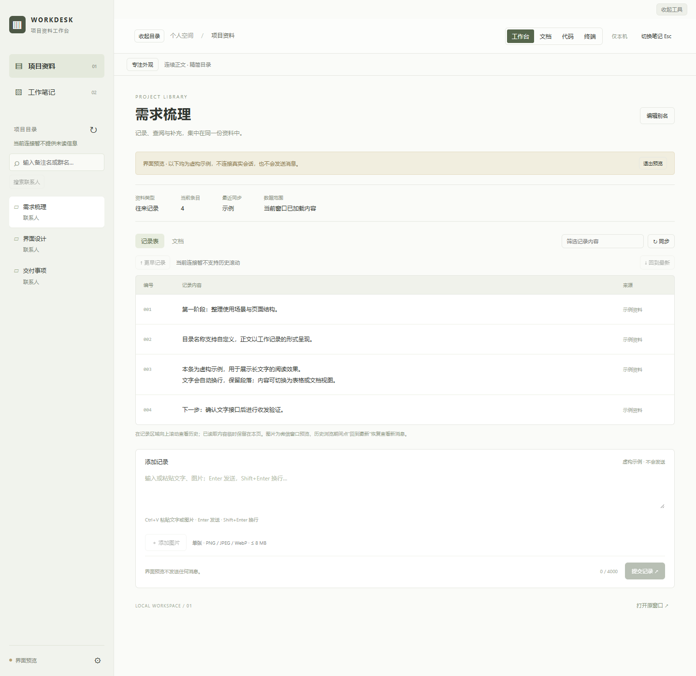
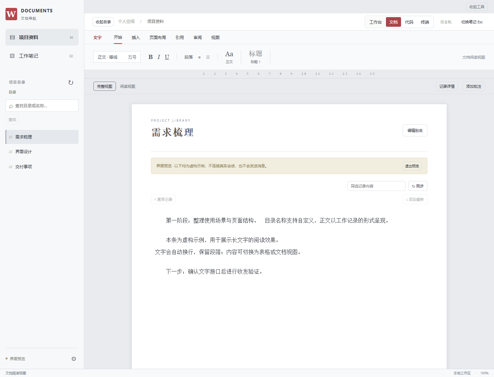
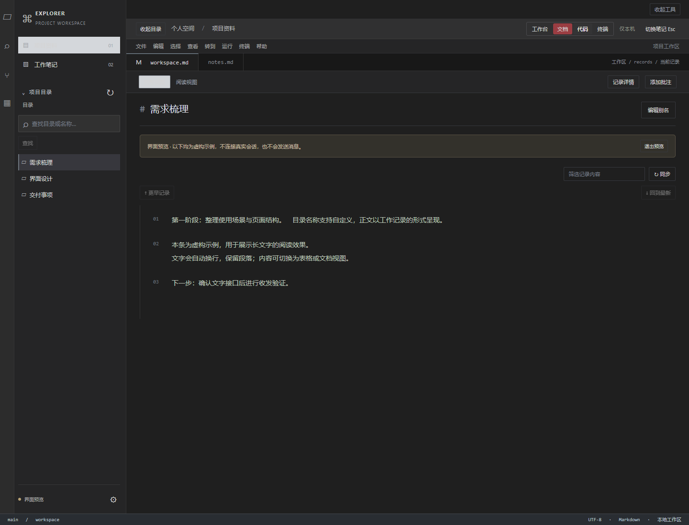
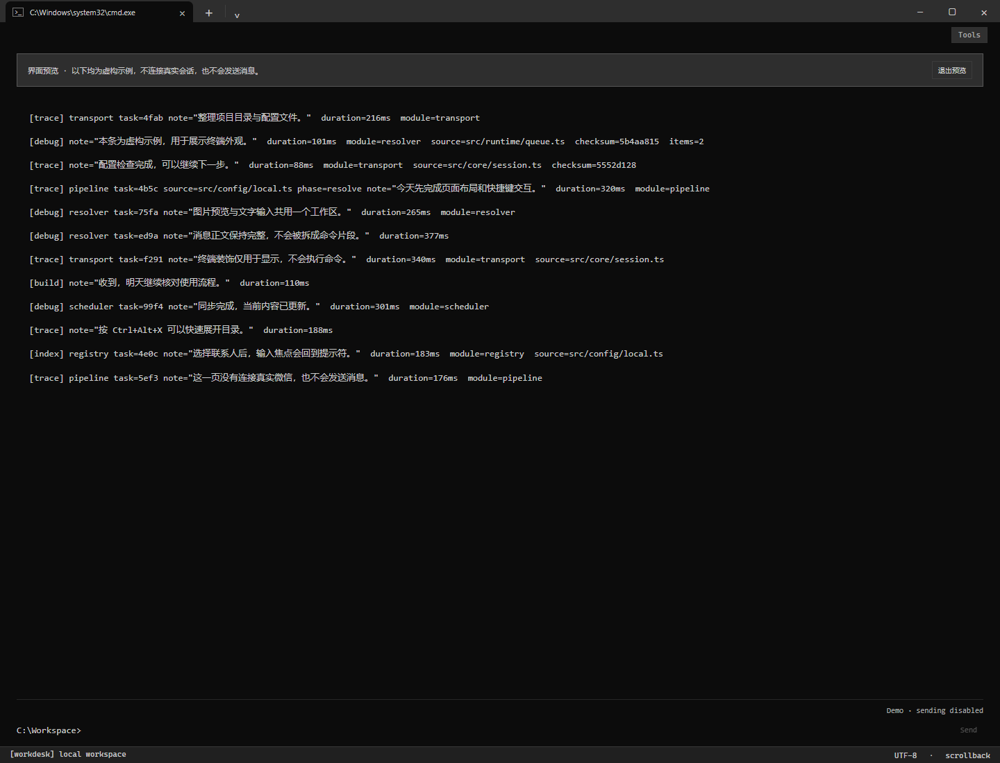

# Workdesk · 项目资料工作台

Workdesk 是一个运行在 Windows 本机的微信界面辅助工具：将电脑微信中已加载的会话与消息，重新呈现为项目工作台、文档、代码编辑器或终端风格的网页。

它依赖已登录的电脑版微信，通过 Windows UI Automation 读取界面并执行操作；文字控件不可用时尝试本地 OCR。它不是独立微信客户端，也不是微信官方网页版。

**直接使用：** [下载 Windows 组合便携包](https://github.com/zhiqianzheng/Workdesk/releases/latest)（含 WindowOpacity 和中文使用说明）。完整解压后双击 `Workdesk-Plus.exe`，会自动启动本地服务并打开网页。

## 效果预览

以下为实际网页界面截图，使用虚构演示数据，不包含真实联系人或聊天记录。演示模式禁用发送，图中的灰色按钮不代表正式连接后的状态。点击图片可查看原图。

| 项目工作台：目录、记录与输入区 | 文档：纸张布局与连续正文 |
| --- | --- |
| [](docs/screenshots/workdesk.png) | [](docs/screenshots/document.png) |

| 代码：文件目录与编辑器外观 | 终端：日志排版与单行提示符 |
| --- | --- |
| [](docs/screenshots/code.png) | [](docs/screenshots/terminal.png) |

通过顶部外观按钮切换风格；终端截图展示了收起目录和工具后的布局，可用 `Ctrl+Alt+X` 展开目录。

## 功能

- **四种外观**：工作台、文档、代码、终端，可切换并记住选择。
- **联系人与群聊**：显示真实名称，支持搜索、切换、未读数量和最新消息预览。
- **文字聊天**：输入或粘贴文字，Enter 发送，Shift+Enter 换行；输入框随多行内容增高。
- **图片**：选择或粘贴图片发送；显示微信当前窗口可读取到的图片预览，支持放大查看。
- **历史记录**：向上滚动逐步加载更早消息，支持回到最新位置。
- **连续输入**：选中联系人后自动收起目录并聚焦输入框；发送后恢复输入焦点。
- **本地笔记与别名**：保存工作笔记、外观偏好和会话显示别名，不修改微信备注。
- **可折叠界面**：联系人目录与辅助工具可以隐藏，终端模式保留简洁提示符。

终端中的命令、路径和日志字段只是排版装饰，不会执行。真实消息正文保持完整，装饰内容不会被发送。

## 运行条件

- Windows x64；便携包已在 Windows 11 x64 上进行本机验证。
- 电脑版微信已登录，保持主窗口打开且未最小化。窗口可以被其他窗口遮挡。
- 完整功能需要微信提供可用的界面文字控件；不同微信版本、系统版本及缩放设置的兼容性需要实际确认。
- OCR 备用方式依赖 Windows 的文字识别语言支持；没有可用语言时，需要安装相应语言包。

不支持 macOS 和 Linux。无需开放防火墙端口或部署公网服务。

## 从源码运行

在 Windows PowerShell 中执行，建议使用 Python 3.12 x64：

```powershell
git clone https://github.com/zhiqianzheng/Workdesk.git
cd Workdesk
py -3.12 -m venv .venv
.\.venv\Scripts\python.exe -m pip install uiautomation==2.0.29 comtypes==1.4.17 Pillow==11.3.0 winsdk==1.0.0b10 windows-capture==2.0.1 numpy==2.5.4 opencv-python==5.0.0.93
.\.venv\Scripts\python.exe server.py
```

先登录电脑微信，再启动工作台。服务启动时会自动打开带本机会话凭据的网页，地址为 `http://127.0.0.1:18765`；页面会随后隐藏地址中的凭据。请不要转发启动链接或把它当成固定书签。

创建好上述 `.venv` 后，也可以运行无控制台启动入口：

```powershell
.\.venv\Scripts\pythonw.exe launch.pyw
```

不要直接双击 `web/index.html`：网页需要本地服务提供连接和操作接口。

## 便携包使用方式

如果你拿到已打包的 Windows 便携压缩包：

1. **完整解压**，保留程序和 `_internal` 等文件夹的相对位置。
2. 登录电脑微信，进入普通聊天，保持窗口未最小化。
3. 双击 `Workdesk.exe`。它会自动启动本地服务并打开网页，无需安装 Python。
4. 如果使用组合包，可双击 `Workdesk-Plus.exe`，同时启动工作台和透明度工具。

本仓库提交的是运行源码，不包含便携 EXE、Python 环境、打包产物或 WindowOpacity 二进制。不要把下载仓库源码的 ZIP 当成可直接运行的便携包。

## 聊天与快捷键

| 操作 | 用法 |
| --- | --- |
| 展开／收起联系人列表 | **Ctrl+Alt+X**；展开后聚焦搜索框 |
| 切换会话 | 点击联系人或搜索结果；确认成功后收起目录并聚焦输入框 |
| 发送文字 | **Enter** |
| 输入换行 | **Shift+Enter** |
| 粘贴文字或图片 | **Ctrl+V**；图片预览后点击发送图片 |
| 切换工作笔记 | **Esc** 或 **Ctrl+Shift+Space** |
| 样式、历史与设置 | 展开 **Tools**；设置入口位于联系人侧栏底部 |

快捷键仅在工作台网页获得焦点时有效。发送前请核对输入区旁显示的实际收件人；终端模式显示为 `To: 联系人`。首次试用建议使用你自己的“文件传输助手”。

## 可选：窗口透明度

组合包可搭配独立项目 [WindowOpacity](https://github.com/zhiqianzheng/WindowOpacity)。工作台与透明度工具是两个独立进程，组合入口只负责启动工具，不会自动调整微信透明度或设置开机启动。

- 默认将鼠标放在目标窗口上，按住 **Shift+向下滚轮**降低不透明度，**Shift+向上滚轮**恢复清晰。
- 点击系统托盘图标打开控制面板，可以恢复所选窗口或全部窗口。
- 右键托盘图标，选择“退出并恢复全部窗口”，可正常退出透明度工具。

具体快捷键及其他功能请以 WindowOpacity 对应版本的说明和用户设置为准。先确认当前透明度下工作台仍能正常读取；不同窗口渲染方式可能影响效果。

## 数据与发送行为

- 服务仅监听本机 `127.0.0.1`，API 使用启动时生成的访问凭据；不读取微信数据库、不提取账号密钥、不注入微信进程。
- 工作台不会将读取到的聊天内容上传到外部服务器；消息本身仍由微信负责发送和接收。
- 工作台读取的聊天内容与草稿保存在运行内存中，刷新或退出前请保留未发送内容。笔记、别名和界面偏好保存在当前浏览器本地。
- 源码模式的会话凭据位于 `.runtime`；便携模式位于当前用户的 `%LOCALAPPDATA%\Workdesk\runtime`。这些文件不应提交或分享。
- 发送前会核对当前对象与输入内容；发送时会替换微信当前输入框中的旧草稿。
- 确定未点击发送时，保留网页草稿供手动重试；已点击但结果未知时，不会自动补发。请先核对微信原窗口，避免重复发送。
- 图片发送会临时使用系统剪贴板，操作结束后尝试恢复；期间若剪贴板被用户更新，会保留用户的新内容。

## 使用限制与常见问题

**连接失败**：确认微信已登录、未最小化、没有阻塞弹窗，并进入普通聊天，再点重新连接。微信界面更新可能需要重新适配。

**凭据失效**：重新运行启动入口打开网页。源码模式也可停止后重新运行 `server.py`，使用它自动打开的新页面。

**端口占用**：先停止已有的工作台服务，再启动新实例。源码模式可使用 `server.py --port 18766` 指定其他端口。

**只显示部分历史或图片**：工具读取的是微信界面加载的记录，历史需逐步滚动加载，图片主要是窗口预览，不能保证完整历史或原图。

**退回 OCR 后功能变少**：OCR 备用方式只支持有限的文字读取与发送，联系人搜索、会话切换、历史滚动和图片发送等功能可能不可用，识别也可能出现误差。

**语音、视频、公众号等**：仍在微信操作。自动化操作有时会短暂激活原窗口；界面换皮不会隐藏微信的系统通知或任务栏。

**如何完全退出**：关闭网页不一定停止后台服务。展开 Tools 和联系人目录，在左下角设置中选择“停止本地服务”；透明度工具需从其托盘菜单单独退出。

## 源码结构

| 文件 | 作用 |
| --- | --- |
| `server.py` | 本地 HTTP 服务、访问校验和操作调度 |
| `bridge.py` | 微信 UI Automation 接入 |
| `connection.py`、`ocr_bridge.py` | 接入切换与 OCR 备用实现 |
| `media.py`、`clipboard_image.py` | 图片预览、剪贴板和图片发送 |
| `native_input.py` | 绑定窗口的原生输入操作 |
| `web/` | 网页界面、样式与交互 |
| `launch.pyw`、`portable.pyw` | 源码与便携版启动入口 |

本项目为非官方界面辅助工具，与腾讯或微信官方无关联。
