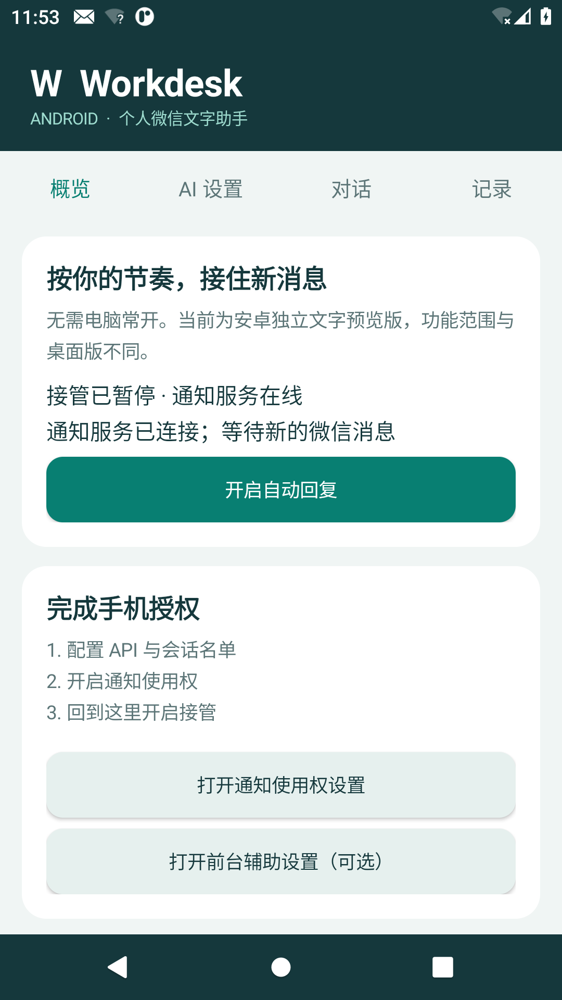

# Workdesk Android 0.1.0-preview.1

独立运行的原生 Android 文字助手，Android 9（API 28）及以上。不需要电脑常开，也不是桌面工作台套 WebView。APK 不包含 API、密钥、微信登录态或测试用的仿真微信应用。

模拟器界面预览（合成验收环境，不含真实聊天或密钥）：



## 安装与开始

1. 安装 Release 中的 `Workdesk-Android-v0.1.0-preview.1.apk`。首次安装来自浏览器/文件管理器的 APK 时，按手机系统提示允许该来源安装。
2. 在「AI 设置」填写 HTTPS API URL、模型 ID 与 Key。支持基址 `https://服务/v1` 或完整 `/v1/chat/completions`。可先查询模型再测试文字连通性；列表不保证每个模型都可用。
3. 在「概览」打开系统通知使用权，让目标会话发一条新通知。在设置中「从新通知中选择会话」或每行手动填写一个完整通知标题，保存并勾选提交文字与自动回复授权。
4. 回「概览」开启接管。只处理开启后的新文字通知，不补回旧聊天；暂停后不自动恢复。设置保存会暂停接管，需要重新确认开启。
5. 微信通知没有快捷回复入口时，可在系统中开启「Workdesk 前台发送辅助」，并在 AI 设置单独勾选。此方式需要屏幕亮着、手机解锁，会打开微信；不适合要求完全后台运行的情况。部分 Android 会先要求手动允许应用的受限设置，遵循系统提示授权。

不要让手机和电脑同时接管同一会话，否则可能各发一条回复。手机开关与桌面开关互不联动。

## 能力边界

| 能力 | 安卓首版 |
| --- | --- |
| 自然文字/emoji 回复 | 支持，共用桌面版 Humanizer-zh 表达规则 |
| 微信通知快捷回复 | 仅限微信实际提供 RemoteInput 的通知；受微信版本影响 |
| 前台文字辅助 | 用户单独开启后，核对标题、原消息、空草稿及发送按钮；不符合条件不点击 |
| 会话选择 | 按通知标题精确匹配；同名会话无法从标题区分，勿加入歧义名单 |
| 联网问答 | 可选，需要服务支持 Responses `web_search` |
| 独立 AI 对话/API 测试/模型查询 | 支持，不会把测试或独立对话发送微信 |
| 自动图片、语音转写、视频、文件 | 不支持；不能把此 APK 视为桌面版的完整替代 |
| 文件传输助手个人接管、本人微信口令 | 不支持；只能在安卓界面控制开关 |
| 静音/免打扰/通知不显示文字/微信正在前台 | 可能没有可接管的新通知 |
| 完整聊天历史与关闭屏幕后保证运行 | 不保证，受 Android 与厂商后台策略限制 |

通知提交和前台点击只能证明调用了发送入口，不能证明对方收到。未知发送结果不自动重试。前台界面可能因微信版本、语言、字体、窗口大小变化而不匹配，需要真实手机验收；本版本未宣称适配所有微信版本。

## 数据

API 配置与选定名单用 Android Keystore AES-GCM 加密，禁止明文 HTTP，不跟随 API 重定向；改 URL 必须重新提供密钥，旧密钥不会转发到新地址。关闭云备份与设备迁移。API 仅收到已授权范围内处理所需的通知文字；独立对话在点击发送后提交。

最近观察到的通知标题、对话和状态仅在内存；不会持久化联系人与聊天正文。持久化的运行数据只有开关、时间边界与有限 SHA-256 去重摘要。前台辅助仅访问微信窗口，不绕过锁屏、不覆盖草稿。没有远程指令执行、终端、Root 或任意文件读取能力。表达规则参考 Humanizer-zh，MIT 许可随 APK assets 提供。

## 构建与验证

需要 JDK 17、Android SDK platform 35、build-tools 35.0.0。运行目录为仓库根目录：

```bash
export ANDROID_HOME=/你的/Android/SDK
python3 scripts/build_android.py
```

首次本机构建在 `~/.local/share/workdesk-android-signing` 创建更新签名并保留；后续版本须使用同一签名且增加 versionCode。不要提交这个目录，备份时妥善保护。CI 使用仓库 Actions secrets `WORKDESK_ANDROID_KEYSTORE_BASE64` 与 `WORKDESK_ANDROID_STORE_PASSWORD`，缺少时拒绝使用临时签名冒充正式更新。

`python3 scripts/test_android_emulator.py` 在专用 API 30 模拟器安装测试包，验证 Keystore、URL/名单、暂停代次、去重、服务权限和原生界面。SDK 需另装 `emulator` 与 `system-images;android-30;default;x86_64`。脚本拒绝使用真实手机或已存在的未知模拟器。

`android/fixture` 是仅用于隔离模拟器的合成通知发送端，故意使用微信包名验证来源与回复回调；不能安装到日常手机，也不发布它的 APK。可选 `--integration-config /私有测试配置.json` 验证真实模型 API 与合成通知的链路，输入配置只进入模拟器本机加密存储，不进入发布包。这个测试不代表已验证真实微信的通知和界面。
